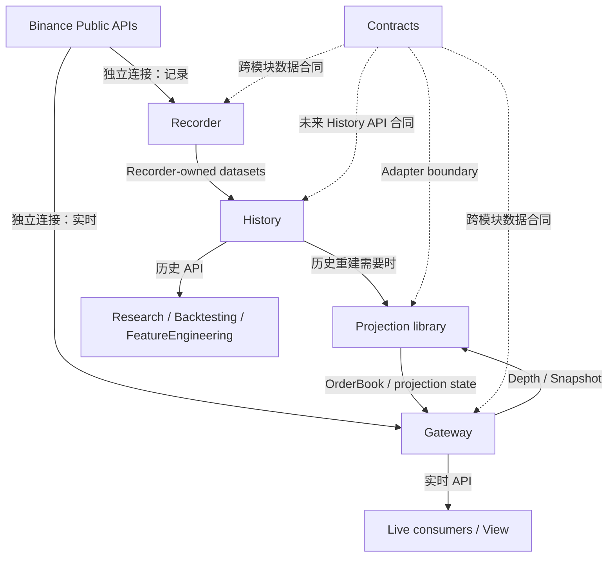

# BinanceMarketData 顶层持续架构

> **文档类型**：Living Architecture Document
> **状态**：CURRENT TOP-LEVEL ARCHITECTURE
> **版本**：0.4.0
> **最后更新**：2026-11-10
> **用途**：定义 BinanceMarketData 的长期职责边界、组件关系、数据流、依赖规则和架构不变量。仓库内部的 SHA、里程碑、容量和运行状态由各仓库自己的 `CURRENT_STATE.md` 维护，不写入本文。

---

## 1. 一句话定义

`BinanceMarketData` 是量化交易系统中的 **Binance 公共市场数据子系统**。

它负责：

- 从 Binance 公共 REST / WebSocket 获取市场事实；
- 可靠记录并保存这些事实；
- 将深度事件确定性地投影为本地订单簿状态；
- 向实时消费者提供低延迟数据；
- 向研究、回测和界面提供可验证的历史查询；
- 暴露数据质量、完整性和运行状态事实。

它不负责 Alpha、预测模型、策略特征、买卖信号、风险审批、账户、仓位、订单、API Key 或交易权限。

```text
MarketData 告诉其他模块“市场发生了什么、现在是什么状态、数据是否可信”。
Feature / Strategy / Risk 决定“这些事实意味着什么、是否应该交易”。
```

---

## 2. 顶层组件

当前顶层只承认六个有明确名字的逻辑组件：

1. `BinanceMarketDataContracts`
2. `BinanceMarketDataRecorder`
3. `BinanceMarketDataProjection`
4. `BinanceMarketDataGateway`
5. `BinanceMarketDataHistory`
6. `BinanceMarketDataView`

`Health` 与 `Control` 是横切能力，不是默认独立系统。只有真实规模和运维需求证明需要时，才升级为独立组件。



关键理解：

- **Recorder 是录像机**：保存“Binance 当时到底发了什么”。
- **Projection 是计算库**：把 Snapshot + DepthUpdate 还原为“当前订单簿是什么”。
- **Gateway 是实时服务器**：连接 Binance、调用 Projection，并把实时结果提供给下游。
- **History 是历史查询层**：读取 Recorder 保存的数据；需要历史订单簿时复用 Projection。
- 下游消费者不把 Projection 当成网络服务使用；Projection 是嵌入 Gateway / History 的共享语义引擎。

---

## 3. 数据流

### 3.1 事件路径

消费者想知道“Binance 刚刚发生了什么”：

```text
Binance -> Gateway transport/parser -> canonical market event -> SubscribeEvents -> consumer
```

典型数据是 `DepthUpdate`、`AggTrade`、`BookTicker`。这条路径不要求事件先经过 Projection。

### 3.2 订单簿状态路径

消费者想知道“应用这些变化后，现在订单簿是什么”：

```text
Binance -> Gateway -> ExchangeDepthSnapshot + ordered DepthUpdate
        -> embedded Projection -> LocalOrderBookSnapshot / accepted ordered updates
        -> Gateway publication -> SubscribeOrderBook -> consumer
```

Projection 不拥有 socket、gRPC server、subscriber 或独立进程生命周期。

### 3.3 历史路径

```text
Recorder Raw -> Recorder Normalize/Replay/Dataset -> History -> historical consumer
```

需要 point-in-time order book 时，History 复用 Projection，而不是实现第二套 sequence/order-book authority。

---

## 4. 组件职责

### 4.1 BinanceMarketDataContracts

**负责**

- 公共数据类型与字段语义；
- Protobuf / Pydantic / JSON Schema；
- wire compatibility；
- 时间、标识、单位和 presence 语义；
- Gateway RPC contract；
- C++ message package 与独立的 C++ gRPC service/stub package。

**不负责**

- Binance 网络连接；
- order-book sequence 分类；
- Projection lifecycle；
- Recorder 存储；
- Gateway runtime；
- UI。

Contracts 是跨模块合同 authority，但不是“所有内部代码都必须依赖的中央框架”。例如 Projection Core 不依赖 Protobuf/gRPC；只有可选 ProtoAdapter 消费 Contracts message package。

### 4.2 BinanceMarketDataRecorder

Recorder 是 BinanceMarketData 的 **durable system of record**。

**负责**

- 独立 Binance Spot / USD-M 公共连接；
- exact Raw capture 与 receive/provenance/connection evidence；
- 有界 ingress、durable spool、Raw chunk / seal / manifest；
- Catalog、crash recovery、reconnect / gap durable evidence；
- archive 生命周期、normalize、replay、historical import；
- storage / capacity / operational evidence。

**不负责**

- 低延迟实时行情；
- Gateway subscriber lifecycle；
- 对外实时 gRPC；
- strategy feature 或 trading。

Recorder 可以保留自身用于 capture quality、gap/resync 和验证的内部 order-book 逻辑，但这不是跨模块 consumer-facing order-book authority。

### 4.3 BinanceMarketDataProjection

Projection 是 **strategy-independent、deterministic、replayable、single-writer 的嵌入式 C++ 库**。

**负责**

- fixed-point numeric semantics；
- deterministic `OrderBook`；
- Spot / USD-M sequence policy；
- stale / duplicate / bridge / gap classification；
- projection lifecycle、reset / resync semantics；
- optional Contracts `ProtoAdapter`；
- `LocalOrderBookSnapshot` construction。

**不负责**

- REST / WebSocket；
- Binance connection lifecycle；
- threads / scheduler / runtime queues；
- gRPC、persistence、subscriber management；
- strategy features。

Projection 逻辑独立，但 Phase 1 不作为独立服务：Gateway 嵌入它做实时订单簿，History 嵌入它做历史重建。相同有序输入和配置必须得到相同确定性结果。

“可以确定性计算”不意味着“应该塞进 Projection Core”。OHLCV、trade tape、premium、funding composition、OBI、microprice 等派生能力必须单独证明其共享语义必要性，不能仅因为确定性就扩张 Core。

### 4.4 BinanceMarketDataGateway

Gateway 是低延迟实时 serving host。

**负责**

- 独立 Binance REST / WebSocket；
- symbol metadata、receive timestamps、transport parsing；
- connection identity / generation；
- bootstrap buffering、REST snapshot acquisition；
- reconnect / resync orchestration、planned rotation；
- bounded ingress / egress；
- serialized Projection scheduling；
- subscription admission、slow-consumer isolation、gRPC serving；
- `gateway_instance_id` / `subscription_id` / `session_sequence`；
- realtime status / telemetry facts。

**不负责**

- 第二套 order book 或 sequence classifier；
- durable Raw archive / historical persistence；
- strategy feature 或 trading。

Gateway 拥有 orchestration，Projection 拥有 order-book semantics。Gateway 必须遵循 Projection 的分类结果，不得自己实现第二套 continuity authority。

### 4.5 BinanceMarketDataHistory

History 是历史查询 / serving layer，不是第二个 Recorder。

**负责**

- dataset discovery、time-range query、gap / coverage query；
- historical event query、point-in-time query；
- replay/query interface、lineage / version exposure；
- 必要时嵌入 Projection 重建历史 order book。

**不负责**

- 第二套 Raw persistence 或 Catalog authority；
- 修改 Recorder 历史；
- 复制 order-book sequence semantics；
- strategy backtest、feature computation、realtime serving。

History 优先从 library / CLI / local query boundary 开始；只有在跨进程、跨设备或并发 consumer 的真实需求出现后，才升级为独立服务。

### 4.6 BinanceMarketDataView

View 是人看的界面。

```text
实时：View -> Gateway
历史：View -> History
状态：View -> 各组件公开 status/read API
```

**不负责**直接连接 Binance、直接读取 Recorder SQLite/Raw、自己重建订单簿、自己定义 sequence semantics 或 strategy/trading。浏览器协议转换属于 View Backend / BFF，不要求 Gateway 为浏览器改变核心 gRPC contract。

---

## 5. Health 与 Control：现在是能力，不是系统

每个组件首先对自己的状态负责，可报告 last event age、gap/resync、queue occupancy、connection state、subscriber count、latency、storage runway、archive backlog 和 process resources。

当前不建立独立 `BinanceMarketDataHealth` 或 `BinanceMarketDataControl` 服务。只有出现多实例、多地域、大量运行组件或真实集中控制需求时，才建立 aggregator / control plane。

MarketData 可以报告 `STALE`、`GAP_PRESENT`、`NEEDS_RESYNC`、`UNAVAILABLE` 等事实，但不决定禁止开仓、减仓或停止交易；这些决定属于 `RiskManagement`。任何 Control 都不得直接篡改其他模块的数据库或内部文件。

---

## 6. 数据层级

| 层级 | 内容 | Owner |
|---|---|---|
| L0 Raw Source Evidence | exact source payload、receive evidence、connection/provenance、durable gap/lifecycle evidence | Recorder |
| L1 Canonical Market Events | `DepthUpdate`、`AggTrade`、`BookTicker`、`ExchangeDepthSnapshot` | Contracts schema；producer 可以是 Recorder、Gateway 或 History adapter |
| L2 Deterministic Market State | synchronized local order book、`LocalOrderBookSnapshot`、projection lifecycle/status | Projection semantics |
| L3 Strategy Features | OBI、microprice、RSI/MACD、z-score、alpha factors、model features | FeatureEngineering |

L0 原则是不可变、可验证、可追踪。L2 的 `MarketStateSnapshot` 仍是较宽的未来 composition surface，当前架构不要求为了填满它而扩张 Projection。L3 不得反向塞回 MarketData core。

---

## 7. Live 与 Historical 必须共享语义

```text
实时：Binance -> Gateway -> Projection -> OrderBook
历史：Recorder dataset -> History replay -> Projection -> historical OrderBook
```

目标 invariant：

> 同一合法 ordered input、相同 NumericSpec、相同 Projection configuration，live 与 replay 必须得到相同确定性 projection 结果。

这不要求 Recorder 重写为 C++ Projection；它要求 consumer-facing projection semantics 只有一个共享 authority。

---

## 8. 时间、标识与排序域

以下域必须分开，不得混用：

- **时间**：exchange event time、trade/transaction time、local receive wall time、monotonic runtime time、publish time、consumer receive time、historical replay/simulation clock。
- **Sequence / identity**：Binance `U/u/pu`、Projection `last_update_id`、Gateway `connection_id` / `connection_generation`、`gateway_instance_id`、`subscription_id`、per-subscription `session_sequence`、Recorder storage/chunk/manifest identities。

不得使用含义模糊的 `timestamp` 代替所有时间；不同 sequence/identity 禁止互相替代。

---

## 9. 可靠性与有界性

1. Recorder 与 Gateway 使用 **独立 Binance connections**。
2. Gateway 不依赖 Recorder 才能运行；Recorder 不依赖 Gateway 才能记录。
3. 所有 runtime queue / buffer 必须有明确上限。
4. 慢消费者不得无限阻塞 Binance ingress、Projection mutation 或其他消费者。
5. contiguous delivery 不允许 silent drop。
6. continuity 一旦失去，必须显式 gap / terminate / resubscribe / rebootstrap。
7. 原始历史事实不可静默改写。
8. 派生数据必须可追踪到 source + schema + producer/build version。
9. 不因为“未来可能需要”提前引入 Kafka、Kubernetes、generic event bus、plugin framework、DI framework 或 lock-free infrastructure。

---

## 10. 部署模型

```text
Storage-oriented host:  Recorder
Latency-oriented host:  Gateway + embedded Projection
Local/offline first:    History + embedded Projection when needed
Web/UI later:           View + BFF
Contracts:              package/schema, not a runtime service
```

Recorder 与 Gateway 可以在不同机器上运行，并保持独立 failure domain。Projection 不需要单独部署。History 是否最终独立服务由真实 consumer / concurrency / remote-query 需求决定。

---

## 11. 对整个量化系统的接口

- **LiveStrategy**：主要通过 Gateway 的 `SubscribeOrderBook`、`SubscribeEvents` 和 status。
- **FeatureEngineering**：实时 feature 可消费 Gateway；离线 feature 主要消费 History。FeatureEngineering 的输出不属于 MarketData。
- **StrategyResearch / Backtesting**：主要通过 History / Replay，必要时复用 Projection 重建历史 order book；不得直接依赖 Recorder 内部文件布局作为长期公共接口。
- **RiskManagement**：可以消费 MarketData 的 data-health facts，但交易允许/禁止决策由 RiskManagement 自己拥有。
- **Execution / Portfolio**：不属于 BinanceMarketData dependency core。

---

## 12. 架构不变量

以下规则是后续开发的默认 gate：

- **MD-INV-01**：Recorder 与 Gateway 独立连接 Binance。
- **MD-INV-02**：Recorder 是 durable source of record。
- **MD-INV-03**：Gateway runtime 不依赖 Recorder。
- **MD-INV-04**：Projection 是 embedded deterministic library，不是网络服务。
- **MD-INV-05**：下游实时消费者连接 Gateway，不直接连接 Projection。
- **MD-INV-06**：consumer-facing order-book / sequence / gap semantics 由 Projection 单一拥有。
- **MD-INV-07**：Gateway 拥有 transport/orchestration，但不得创建第二套 Projection semantics。
- **MD-INV-08**：History 是 query/serving layer，不成为第二个 Recorder。
- **MD-INV-09**：View 是 consumer，不读取 Raw/Catalog internals，不实现 market semantics。
- **MD-INV-10**：Health / Control 当前是 capability，不是默认独立 service。
- **MD-INV-11**：所有 runtime queue/buffer 有界；silent continuity loss 禁止。
- **MD-INV-12**：不同 clock / sequence / identity domain 不混用。
- **MD-INV-13**：strategy-specific feature 不进入 MarketData Core。
- **MD-INV-14**：历史/派生产品必须保留 provenance 与 version identity。
- **MD-INV-15**：Live 与 historical replay 复用同一 consumer-facing Projection semantics。
- **MD-INV-16**：没有 measurement / concrete requirement，不引入通用框架和分布式基础设施。

违反这些 invariant 的实现必须先做明确的架构变更和 review，不能在 feature PR 中顺带改变。

---

## 13. 当前受控开放问题

| ID | 问题 | 当前方向 |
|---|---|---|
| O-001 | History 最终是 library 还是 service | 先 library/CLI；真实 remote/concurrency 需求出现再服务化 |
| O-002 | View 何时开发 | History API 和 Gateway realtime surface 足够稳定后 |
| O-003 | 是否需要独立 Health aggregator | 当前不需要；多实例/多地域规模出现后再评估 |
| O-004 | 是否需要独立 Control plane | 当前不需要；集中运维需求出现后再评估 |
| O-005 | `MarketStateSnapshot` 的最终 composition | deferred；不为填 schema 强迫 Projection 膨胀 |
| O-006 | OHLCV / tape / premium 等 deterministic derived data 放哪里 | 逐项设计；“可确定性计算”本身不足以进入 Projection Core |
| O-007 | Contracts formal release / package revision | release concern；当前不是 Gateway/Projection engineering blocker |
| O-008 | Recorder-local quality orderbook 与 consumer-facing Projection 的长期语义对齐 | 保持职责隔离；任何统一必须另行设计和验证 |

---

## 14. 文档与架构治理

本文是 **BinanceMarketData 跨仓顶层边界与开发方向 authority**，但不替代 Binance 官方协议事实、各仓库内部算法/lifecycle ADR、Contracts wire schema、Recorder durable-format/storage contracts、Projection sequence semantics 或 Gateway runtime milestone acceptance。

当顶层边界与旧的 repository-local 文档冲突时：不允许静默选择；先确认哪份是更新的有效 authority；在开始受影响 milestone 前完成文档对齐；涉及 public schema / persistent format / sequence semantics 的变化必须走对应 repo 的正式 ADR / compatibility review。

本文只记录长期边界。某一次 CI run、temporary SHA、bug forensic、函数级说明和短期运行状态应留在各仓库的 `CURRENT_STATE.md` / evidence / Git 历史中。

必须更新本文的情况：新增/删除一级组件、组件 ownership 变化、依赖方向变化、consumer-facing data flow 变化、Health/Control 升级为独立系统、MarketData 与 Feature/Strategy/Risk 边界变化、部署 failure domain 重大变化。

---

## 15. 给新开发者的一分钟版本

```text
Contracts  = 大家交换数据时使用的公共语言。
Recorder   = 录像机：把 Binance 历史事实可靠保存下来。
Projection = 计算库：把 Snapshot + DepthUpdate 确定性还原成订单簿。
Gateway    = 实时服务器：连接 Binance，调用 Projection，向下游提供实时事件和订单簿。
History    = 历史查询层：读取 Recorder 数据，需要时调用 Projection 重建历史订单簿。
View       = 给人看的界面：实时看 Gateway，历史看 History。

Health / Control = 目前是各模块自己的能力，不是新建两个系统。
```

如果一个新功能不知道放哪里，先问：

```text
它是在记录事实？          -> Recorder
它是在定义公共数据语义？  -> Contracts
它是在确定性重建订单簿？  -> Projection
它是在实时连接和交付？    -> Gateway
它是在查询历史？          -> History
它是在展示？              -> View
它是在构造预测/策略输入？  -> FeatureEngineering，不属于 BinanceMarketData Core
```
